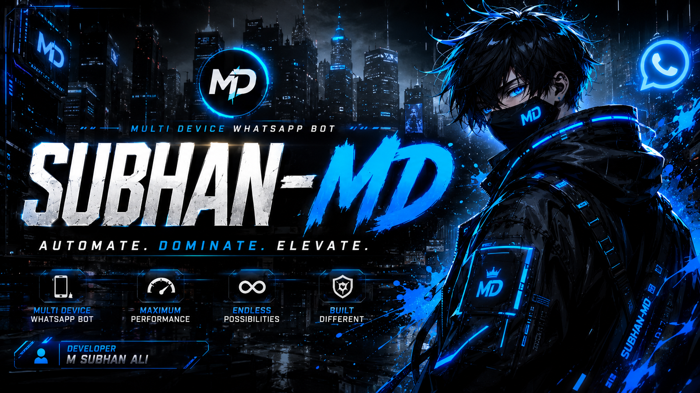

<div align="center">


<a href="https://github.com/subhanmdofficial/subhan-md">
  
</a>

<br><br>



<br><br>

**SUBHAN-MD** (also searched as **Subhan MD bot**, **Subhan MD mini bot**, **Subhan-MD WhatsApp bot**) is a fast, free and open-source **WhatsApp MD bot** built with **Node.js** and **Baileys** by **M Subhan Ali**.

<br>

[](https://github.com/subhanmdofficial/subhan-md)
[](https://github.com/subhanmdofficial/subhan-md/fork)
[](https://github.com/subhanmdofficial/subhan-md)
[](https://github.com/subhanmdofficial/subhan-md/issues)
[](https://github.com/subhanmdofficial/subhan-md/archive/refs/heads/main.zip)


<br>

### 🚀 One-Click Deploy

[](https://heroku.com/deploy?template=https://github.com/subhanmdofficial/subhan-md)
[](https://railway.app/new/template?template=https://github.com/subhanmdofficial/subhan-md)
[](https://render.com/deploy?repo=https://github.com/subhanmdofficial/subhan-md)

</div>

<br>

---

<div align="center">

## ✅ Official Repository

</div>

This is the **original and official SUBHAN-MD repository**, created and maintained by **M Subhan Ali** ([@subhanmdofficial](https://github.com/subhanmdofficial)).

<div align="center">

| | |
|:---|:---|
| 👤 **Original Developer** | M Subhan Ali (SUBHAN MD) |
| 🌐 **Developer Website** | [subhan212.vercel.app](https://subhan212.vercel.app) |
| 📦 **Official Repo** | [github.com/subhanmdofficial/subhan-md](https://github.com/subhanmdofficial/subhan-md) |
| 📜 **License** | MIT — © 2026 M Subhan Ali |

</div>

Forks are allowed under the MIT License, **but the original copyright notice must be kept**. A fork is not the original. If someone claims to own SUBHAN-MD, check that the repo belongs to `subhanmdofficial` and compare the commit history.

<br>

---

## 📖 Table of Contents

[About](#-what-is-subhan-md) · [Features](#-features) · [Commands](#-command-categories) · [Requirements](#-requirements) · [Quick Start](#-quick-start) · [Connect WhatsApp](#-connect-whatsapp) · [Config](#-configuration) · [Deploy](#-free-deployment) · [Database](#-database-support) · [Plugins](#-plugin-system) · [Roman Urdu](#-roman-urdu-guide) · [FAQ](#-faq) · [Troubleshooting](#-troubleshooting)

<br>

---

## 🚀 What is SUBHAN-MD?

**SUBHAN-MD** is a free, open-source **WhatsApp Multi-Device (MD) bot** written in JavaScript on top of the **Baileys** library. It ships with **300+ ready-made commands in 19 categories**, an auto-loading plugin system, group protection, downloaders, stickers, AI chat and image tools, and it runs on free hosting.

Looking for the **Subhan MD mini bot**? SUBHAN-MD is tuned for low-RAM servers (small message store, automatic temp cleanup, memory guard), so it works as a lightweight mini bot on free plans.

<br>

---

## ✨ Features

<div align="center">

| | | |
|:---:|:---:|:---:|
| 🆓 **Free & Open Source**<br><sub>MIT License</sub> | ⚡ **300+ Commands**<br><sub>19 categories</sub> | 🔌 **Auto-Load Plugins**<br><sub>Drop a file, done</sub> |
| 🗄️ **5 Databases**<br><sub>JSON · Mongo · Postgres · MySQL · SQLite</sub> | 🛡️ **Group Protection**<br><sub>Anti-link, spam, badword, call</sub> | 📥 **Downloaders**<br><sub>TikTok, IG, Spotify, FB, X</sub> |
| 🤖 **AI Tools**<br><sub>GPT, Llama, Mistral</sub> | 🎨 **Stickers & Media**<br><sub>Maker, crop, filters, remove bg</sub> | 🎮 **Games**<br><sub>Hangman, TicTacToe, Sudoku</sub> |
| ⏰ **Scheduler**<br><sub>Timed messages</sub> | 🧩 **Pair / Rent System**<br><sub>Host other sessions</sub> | 🖥️ **Deploy Anywhere**<br><sub>Railway, Render, Heroku, VPS, Termux</sub> |

</div>

<br>

---

## 🧩 Command Categories

<div align="center">

| Category | What it does |
|:---|:---|
| 👑 **Owner** | Restart, broadcast, settings, sudo, ban/unban, bot rental |
| 🛡️ **Admin** | Kick, promote, demote, mute, warn, tag all, hidetag |
| 👥 **Group** | Group info, settings, welcome/goodbye, invite links |
| 🛠️ **Tools** | Converters, calculators, text tools, QR code, translate |
| 📥 **Download** | TikTok, Instagram, Spotify, Facebook, Twitter, MEGA and more |
| ☁️ **Upload** | Catbox, Litterbox, Pixhost and other file hosts |
| 🎨 **Stickers** | Create, crop and convert stickers |
| 🖼️ **Images** | Image generation and editing |
| 🤖 **AI** | GPT, Llama, Mistral chat |
| 🎮 **Games** | Hangman, Tic-Tac-Toe, Sudoku, trivia |
| 😄 **Fun** | Jokes, compliments, quotes, shayari, memes |
| 🔎 **Stalk** | Instagram, TikTok, Telegram, GitHub, NPM lookups |
| 🎵 **Music** | Song search, play, lyrics, Shazam |
| 🔍 **Search** | Wikipedia, dictionary, movies, news |
| ℹ️ **Info** | Whois, weather, IP lookup, bot stats |
| 🧰 **Utility** | Everyday helper commands |
| 💬 **General** | ping, alive, uptime |
| 📜 **Quotes** | Quote and text generators |
| 📋 **Menu** | Full command list |

</div>

Send **`.menu`** or **`.list`** in WhatsApp to see every command live.

<br>

---

## ⚙️ Requirements

- **Node.js 20 or higher**
- A WhatsApp number to link (a spare number is recommended)
- Git, or just download the ZIP
- *(Optional)* MongoDB, PostgreSQL or MySQL

<br>

---

## 🏁 Quick Start

```bash
# 1. Clone the repository
git clone https://github.com/subhanmdofficial/subhan-md.git
cd subhan-md

# 2. Install dependencies
npm install

# 3. Create your .env file (see Configuration below)

# 4. Start the bot
npm start
```

Prefer a QR code instead of a pairing code?

```bash
node index.js --qr-code
```

<br>

---

## 🔑 Connect WhatsApp

1. **Pairing code (easiest):** set `PAIRING_NUMBER` in `.env` (country code, no `+` or spaces). Start the bot, then open **WhatsApp → Linked Devices → Link with phone number** and enter the code shown in the logs.
2. **Session ID:** set `SESSION_ID` in `.env`. Good for cloud hosts where you cannot watch the terminal.

> ⚠️ Never share your `SESSION_ID` or `.env` file. It gives full access to your WhatsApp account.

<br>

---

## 🔧 Configuration

Create a file named `.env` in the project folder:

```env
PAIRING_NUMBER=923001234567
OWNER_NUMBER=923001234567
BOT_NAME=SUBHAN-MD
BOT_OWNER=M Subhan Ali
PREFIXES=.,!,/
COMMAND_MODE=public
TIMEZONE=Asia/Karachi
PORT=5000
```

<div align="center">

| Variable | Description | Default |
|:---|:---|:---|
| `SESSION_ID` | Session credential string | empty |
| `PAIRING_NUMBER` | Number that receives the pairing code | empty |
| `OWNER_NUMBER` | Owner WhatsApp number | empty |
| `BOT_NAME` | Bot display name | SUBHAN-MD |
| `BOT_OWNER` | Owner name shown in replies | M Subhan Ali |
| `PREFIXES` | Command prefixes, comma separated | `.` `!` `/` `#` |
| `COMMAND_MODE` | `public` or `private` | `public` |
| `TIMEZONE` | Bot timezone | `Asia/Karachi` |
| `PORT` | Status server port | `5000` |
| `MONGO_URL` | MongoDB connection string | empty |
| `POSTGRES_URL` | PostgreSQL connection string | empty |
| `MYSQL_URL` | MySQL connection string | empty |
| `DB_URL` | SQLite file path | empty |
| `REMOVEBG_KEY` | remove.bg API key (optional) | empty |
| `MAX_STORE_MESSAGES` | Messages kept in memory (lower = less RAM) | 20 |

</div>

Leave all database variables empty to use the built-in JSON storage.

<br>

---

## ☁️ Free Deployment

<div align="center">

| Platform | Button | Config |
|:---|:---|:---|
| **Heroku** | [](https://heroku.com/deploy?template=https://github.com/subhanmdofficial/subhan-md) | `app.json`, `heroku.yml`, `Procfile` |
| **Railway** | [](https://railway.app/new/template?template=https://github.com/subhanmdofficial/subhan-md) | `railway.json` |
| **Render** | [](https://render.com/deploy?repo=https://github.com/subhanmdofficial/subhan-md) | `render.yaml` |

</div>

Also works on a **VPS**, a **Pterodactyl panel** and **Termux** via the [Quick Start](#-quick-start).

<br>

---

## 🗄️ Database Support

| Backend | Variable | Best for |
|:---|:---|:---|
| **JSON** (default) | none | Testing, small bots |
| **MongoDB** | `MONGO_URL` | Cloud hosting |
| **PostgreSQL** | `POSTGRES_URL` | Self-hosted setups |
| **MySQL** | `MYSQL_URL` | Traditional hosting |
| **SQLite** | `DB_URL` | Light local storage |

<br>

---

## 🧩 Plugin System

Every command is one file inside `plugins/`:

```js
export default {
    command: 'ping',
    aliases: ['p'],
    category: 'general',
    description: 'Check bot speed',
    async handler(sock, message, args, context) {
        // your code here
    }
};
```

Drop a new file in `plugins/` and restart. It loads automatically.

<br>

---

## 🇵🇰 Roman Urdu Guide

**SUBHAN-MD kya hai?** Ye free WhatsApp bot hai jo Pakistan me M Subhan Ali ne banaya hai. Isme 300 se zyada commands hain: downloader, sticker maker, AI chat, group protection, games aur bohat kuch.

**Kaise chalayen?**

1. Is repo ko **Fork** ya **Download ZIP** karein.
2. Railway, Render ya Heroku ka **Deploy** button dabayein.
3. `PAIRING_NUMBER` me apna WhatsApp number likhein (country code ke saath, `+` ke baghair).
4. Bot start hone par logs me 8 digit ka code aayega.
5. WhatsApp me **Linked Devices → Link with phone number** me code daalein.
6. Bot me `.menu` likh kar saari commands dekhein.

**Zaroori:** apna `SESSION_ID` aur `.env` file kisi ko na dein.

<br>

---

## ❓ FAQ

<details>
<summary><b>Who made SUBHAN-MD?</b></summary>

M Subhan Ali (SUBHAN MD) from Pakistan. See the [official notice](#-official-repository) above.
</details>

<details>
<summary><b>Is SUBHAN-MD free?</b></summary>

Yes. It is free and open source under the MIT License.
</details>

<details>
<summary><b>Is there a SUBHAN-MD mini bot?</b></summary>

SUBHAN-MD is built to run light on free hosting, so it works as a mini bot on small servers. Lower `MAX_STORE_MESSAGES` to save more RAM.
</details>

<details>
<summary><b>Which hosting is best for a free WhatsApp bot?</b></summary>

Railway, Render and Heroku have ready deploy buttons. A VPS, Pterodactyl panel or Termux also work.
</details>

<details>
<summary><b>Does it use Baileys?</b></summary>

Yes, `@whiskeysockets/baileys` with multi-device support.
</details>

<details>
<summary><b>Can I add my own commands?</b></summary>

Yes. Add a file to `plugins/` and restart. See [Plugin System](#-plugin-system).
</details>

<br>

---

## 🩺 Troubleshooting

| Problem | Fix |
|:---|:---|
| Pairing code not working or QR expires | Delete the `session` folder and link again |
| High RAM on free hosting | Lower `MAX_STORE_MESSAGES` in `.env` |
| Commands do not reply | Check `COMMAND_MODE` and `PREFIXES` |
| Database not connecting | Check the connection string. JSON storage is used if empty |
| Port already in use | Change `PORT` in `.env` |

Still stuck? [Open an issue](https://github.com/subhanmdofficial/subhan-md/issues).

<br>

---

## ⭐ Star History

<div align="center">

<a href="https://star-history.com/#subhanmdofficial/subhan-md&Date">
  
</a>

</div>

<br>

---

## ⚠️ Disclaimer

This project is **not affiliated with, endorsed by, or connected to WhatsApp Inc. or Meta Platforms**. Use it responsibly and follow WhatsApp's Terms of Service. The developer is not responsible for any account restrictions caused by misuse.

## 📜 License

Released under the **MIT License**. See [`LICENSE`](./LICENSE). © 2026 M Subhan Ali.

<div align="center">

**SUBHAN-MD** · Built with 🖤 in Pakistan 🇵🇰 by **M Subhan Ali**

⭐ If this project helped you, please star the repo.

<sub>Keywords: subhan md, subhan-md, subhan md bot, subhan md mini bot, free whatsapp bot, whatsapp md bot, whatsapp multi device bot, baileys whatsapp bot, pakistan whatsapp bot, whatsapp bot github, deploy whatsapp bot free, m subhan ali</sub>


</div>
